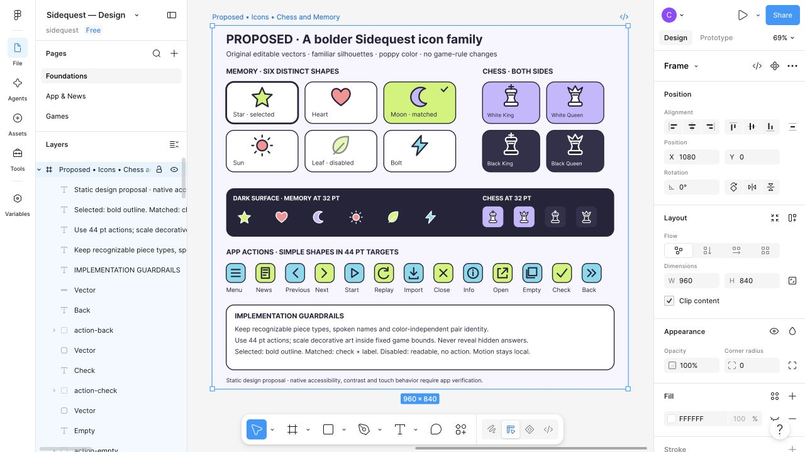

# Proposed vivid icon family

Status: **Proposed**, October 5, 2026, for [#159](https://github.com/devofthings/sidequest/issues/159). The owner specifically requested more vivid Chess pieces and Memory artwork, extending that direction to existing app icons. This design contribution selects no application asset set and changes no game behavior.

The editable [Icons board](https://www.figma.com/design/Ehy0Dmgc1CCV2iTRThwb49/Sidequest-%25E2%2580%2594-Design?node-id=18-295) is on Foundations in the owner's private Sidequest file, beside the previous foundations board at canvas position 1080, 0. The three existing pages and previous boards are preserved. [Original SVG](figma-159/icons.svg) and [actual browser screenshot](figma-159/icons.jpg) keep the proposal inspectable outside Figma. All artwork is original vector geometry authored for this ticket; no external assets, font-glyph Chess pieces, purchases, paid generation or company connector were used.

## Audit and direction

| Existing presentation | Proposed treatment |
| --- | --- |
| Memory's six SF Symbols: star, heart, moon, sun, leaf, bolt | Keep pair identities and spoken names; use colorful outlined original silhouettes. Six face samples illustrate selected Star, matched Moon with check and label, and disabled Leaf. |
| Memory's hidden question mark and matched check | A repeated chevron back is a decorative alternative shared by every hidden tile; keep hidden labels free of answer identity. A familiar check supplements matched text. |
| Chess's Unicode White/Black King and Queen | Distinct cross versus crown silhouettes, substantial bases, consistent outlines and side-specific fill; both sides shown at large and 32-point reference sizes. These are the only implemented piece kinds; other pieces depend on the varied-Chess specification. |
| Feed navigation, news-library and empty-card glyphs | Familiar Menu, News, Previous/Next and stacked-card silhouettes in vivid 44-point reference targets. |
| Fictional-sample information and external-article action | Familiar Info and Open glyphs retain their existing semantic labels and external-link behavior. |
| Existing text Start, Replay, import and Close actions | Optional familiar supporting artwork, never an icon-only replacement for a needed label. The Start example does not restore a dedicated button superseded by #160. |
| Sudoku digits, Bubble objects, completion badge and selected logo | Retain readable numbers, authoritative colored/labeled Bubble objects, existing check/result text and the selected logo. These are not missing icon assets; the wider style and #161 own their feedback. |

Use a consistent simplified silhouette and rounded stroke treatment. Bright lime, coral, cyan and lavender fills sit inside dark outlines on light surfaces; the dark Memory sample switches outlines to white to preserve the Sun rays and Leaf detail. White Chess pieces retain a light fill/dark outline; Black pieces use a dark fill/light outline. Playing-side text remains available. The palette, contours and stroke dimensions are design judgments, not an Apple-prescribed style or proof that users prefer it.

The 52-point Memory and 56-point Chess artwork sits inside fixed sample tiles; the dark strip shows 32-point decorative art, not 32-point touch targets. App-action examples use 44×44 reference backgrounds. Preserve native layout budgets, readable Dynamic Type, VoiceOver names and accessible coordinate/input alternatives when implementing. Selected/matched/disabled examples demonstrate visual intent; they are not functioning controls. Disabled tint is decorative and the text stays readable. Actual contrast, assistive use and physical-device appearance remain unverified.

This is a static vector sheet, not a running prototype or all twelve Memory tiles. It adds no mascot, sound, game type or motion behavior. Icon replacement must preserve answer concealment, semantic identity, inert preview start, fixed game geometry, skip/reset and quiet completed revisits. Small selected outlines and matched checks are supplements to existing spoken/text feedback. Keep animation policy with [the baseline](../DESIGN.md) and [private proposals](PRIVATE_FIGMA.md).

## Evidence and next boundary

Reviewed Apple's primary [Icons](https://developer.apple.com/design/human-interface-guidelines/icons) and [Accessibility](https://developer.apple.com/design/human-interface-guidelines/accessibility) guidance through its official readable DocC JSON on October 5. It supports recognizable simplified metaphors, consistent visual weight and redundant accessible information. Original SVG paths, text and named groups were imported through the signed-in private browser. Actual Figma UI shows editable vector/text layers and the correct Foundations placement; the screenshot was inspected for the small dark symbols and both Chess sides. No account, billing, sharing, page creation or company connection changed.

The native app still uses its existing art. Owner selection of this proposal and a separately bounded implementation are pending. Repository review, documentation checks and exact-head CI must be recorded separately before this contribution is delivered; static design evidence cannot certify native animations, gesture behavior or accessibility.

