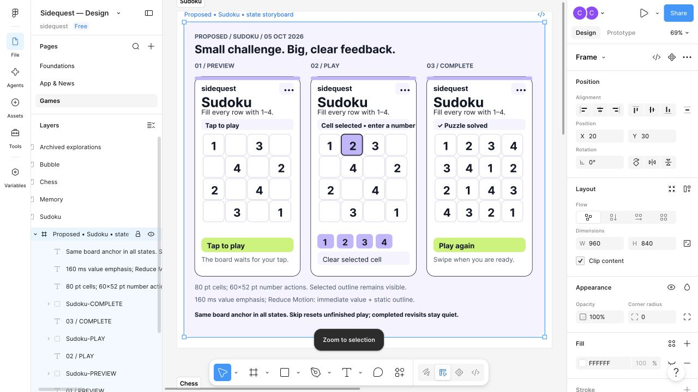
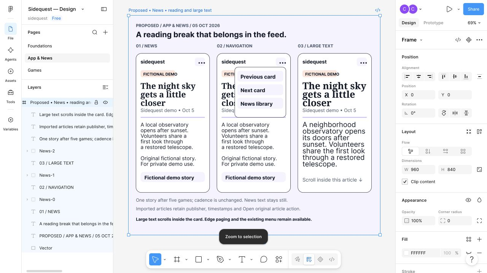

# Private Figma refinement

Status: **Proposed**, October 5, 2026, for [#157](https://github.com/devofthings/sidequest/issues/157). The owner authorized this design pass after #10 feedback that the games felt bland/boring and that news interruptions were enjoyable. The tested device, OS, and build are unknown. The owner remains uncertain about five-game cadence; this proposal preserves the current five-game/news rule.

The editable artifact is [Sidequest — Design](https://www.figma.com/design/Ehy0Dmgc1CCV2iTRThwb49/Sidequest-%25E2%2580%2594-Design) in Chris Winter's private Free team. Creation used ordinary browser UI and clipboard SVG import, which produced editable text/vector layers and named groups. No company connector, paid generation, upgrade, or sharing change was used. Existing Foundations, App & News, Games, and all five game sections remain; Archived explorations stays empty.

## Artifact index

Each game board contains named PREVIEW, PLAY, and COMPLETE groups inside an editable 960×840 frame. They are visual state examples, with logical 380×720 phone compositions displayed at 74% scale. Figma groups are not interactive controls or responsive Auto Layout components.

| Page / section | Editable frame | Actual screenshot | Authored import source |
| --- | --- | --- | --- |
| Foundations | [Motion and accessibility](https://www.figma.com/design/Ehy0Dmgc1CCV2iTRThwb49/Sidequest-%25E2%2580%2594-Design?node-id=2-807) | [Foundations](figma-157/foundations.jpg) | [SVG](figma-157/foundations.svg) |
| App & News | [Reading, navigation, large text](https://www.figma.com/design/Ehy0Dmgc1CCV2iTRThwb49/Sidequest-%25E2%2580%2594-Design?node-id=2-856) | [News](figma-157/news.jpg) | [SVG](figma-157/news.svg) |
| Games / Sudoku | [Three states](https://www.figma.com/design/Ehy0Dmgc1CCV2iTRThwb49/Sidequest-%25E2%2580%2594-Design?node-id=5-2) | [Sudoku](figma-157/sudoku.jpg) | [SVG](figma-157/sudoku.svg) |
| Games / Memory | [Three states](https://www.figma.com/design/Ehy0Dmgc1CCV2iTRThwb49/Sidequest-%25E2%2580%2594-Design?node-id=2-265) | [Memory](figma-157/memory.jpg) | [SVG](figma-157/memory.svg) |
| Games / Chess | [Three states](https://www.figma.com/design/Ehy0Dmgc1CCV2iTRThwb49/Sidequest-%25E2%2580%2594-Design?node-id=15-2) | [Chess](figma-157/chess.jpg) | [SVG](figma-157/chess.svg) |
| Games / Bubble | [Three states](https://www.figma.com/design/Ehy0Dmgc1CCV2iTRThwb49/Sidequest-%25E2%2580%2594-Design?node-id=14-129) | [Bubble](figma-157/bubble.jpg) | [SVG](figma-157/bubble.svg) |

## Owner-approved interaction update #160

On October 5, the owner replaced the dedicated visible start button with a tap-sensitive preview game surface and a lightweight overlay or top-row cue. [Current preview policy](../GAME_PREVIEWS.md) selects top-row informational text, accessible/keyboard Start game activation, transparent content-only tap capture, inert first taps, and native manual swiping. The SVGs and screenshots below retain the earlier button illustration; that treatment is superseded, and this documentation update does not claim the private Figma frames or prototype interactions were changed. Their fixed-board/control reservations remain applicable. #159 separately owns vivid Chess/Memory icon refinement; these artifacts remain Proposed.

## Visual judgment

Refine the [delivered baseline](../DESIGN.md) using larger game names, short goals, tactile opaque objects, one prominent action, and readable status in a reserved strip. Lime indicates the primary action; lavender, coral, and cyan establish the game family. Selection also has a dark outline, and outcomes have text/checkmarks. The quiet news surface uses a serif headline and ordinary body text, making a deliberate reading interruption without new feed destinations. Noto Serif is the available Figma reference font; native implementation would retain the baseline's system serif. Inter in Figma is a system-font approximation, not a new bundled-font dependency.

The boards show the current 4×4 Sudoku, twelve-card/six-pair Memory, White e5–h8 Chess fixture with accepted Qg7, and a schematic two-row Bubble starting footprint in its fixed field. Black Chess retains a1–d4 and full coordinate alternatives. Bubble objects and the illustrative aim path are visual examples, not a validated generated challenge or a recorded shot. The existing imported-article action, attribution, capture/publication metadata, and intentional empty-news behavior remain authoritative. Fictional news copy here is original design data; it is not added to the production pool. The fictional-story strip is metadata, not a new external action.

Chess coordinate and Bubble aim bars summarize existing controls. Their implementation must retain separate labeled, keyboard/VoiceOver-operable selections and at least 44×44-point targets; the drawings do not consolidate them into one control. The menu illustrates existing Previous card, Next card, and News library actions. No adaptive cadence, personalization, geographic news, quiz, daily session, character, sound pack, or new game mechanic is proposed here.

## Geometry and accessibility

All three game states retain the same board anchor and status/control reservations. Sudoku cells are 80 points with 60×52 number actions; Memory tiles are 100×70; Chess squares are 75 in this reference. Shared primary buttons are 332×52. Preserve measured native geometry when implementing rather than forcing these illustrative dimensions into every viewport.

Chess preview/start, Submit move, and completed Play again share logical bounds `x=24, y=631, width=332, height=52`; Bubble preview/start, Fire, and completed Play again share `x=24, y=620, width=332, height=52`. Their footer copy stays below the action. Completed Chess retains its disabled coordinate-row footprint at `y=568, height=48`; Bubble preserves its aiming-row reservation. These reference bounds are identical across each game's three states and exceed the 44-point minimum.

The Foundations board annotates the existing 375×579-point pocket card viewport. At smaller sizes, retain the fixed game footprint and allow inner scrolling for overflowing text/controls. At large Dynamic Type, grow text reservations, keep the existing two-column Memory layout and Chess coordinate alternatives, and allow article scrolling. The News board includes a larger-type example; the four game boards do not claim complete large-type responsive layouts. Maintain edge paging and the accessible navigation menu. Check dark/increased-contrast variants and preserve textual/symbolic alternatives to color. The dark Memory sample communicates palette only, not all twelve cards or a full gameplay screen.

Owner-approved #163 also supersedes Bubble's visible numeric angle labels in these static drawings. Current implementation maps horizontal position across the existing lower-board region to −60°/0°/+60° at left/center/right, independently of vertical position. The real dotted trajectory remains visual guidance; a native 44-point Slider provides assistive/keyboard precision, with named accessible aim feedback and explicit Fire. Releasing a drag does not shoot. Follow [the current aiming policy](../BUBBLES.md#simplified-horizontal-aiming-163). The existing Bubble SVG, screenshot, and private Figma frame remain historical Proposed artifacts; no revised actual drawing is claimed here. The #160 preview-surface start policy remains authoritative.

## Motion storyboard

These are static storyboards, **not a running animated prototype**. Proposed tuning remains local and brief: press fill/outline, roughly 160 ms value or surface emphasis, then a readable settled state. Sudoku selection/value feedback stays within the cell; Memory emphasizes matched backing without delaying answer conceal; Chess emphasizes the accepted destination; Bubble preserves authoritative shot timing and only emphasizes committed removal. Completion uses the existing result region and success policy, with no automatic next card or new reward.

Reduce Motion uses immediate state changes and static outlines/results, with the Bubble in-flight object stationary as already specified. Skip/background/reset cancels transient presentation; restored completed cards stay quiet. Animation completion never owns rule mutation or input eligibility. Manual feed, explicit Tap to play, unfinished skip/reset, completed revisits, current challenge configurations, and cadence remain unchanged.

## Research and evidence

Reused [primary-source baseline research](../research/mvp-design.md) and refreshed Apple's official guidance before drawing: [Motion](https://developer.apple.com/design/human-interface-guidelines/motion), [Buttons](https://developer.apple.com/design/human-interface-guidelines/buttons), and [Accessibility](https://developer.apple.com/design/human-interface-guidelines/accessibility), with readable official DocC JSON. Apple supports purposeful, brief, cancellable motion, optional motion alternatives, recognizable actions, and accessible targets/text. The palette, hierarchy, reference dimensions, and timing above are design judgments; they are not prescribed platform values or proof of greater enjoyment.

Actual browser screenshots were visually inspected for all six boards, including a cleaned serif news layout and noncolor Sudoku outline. UI inspection confirmed named editable text/group/vector layers, correct page/section placement, and retained containers. SVG XML, local documentation links, and Git whitespace checks passed before the documentation commit. No application source, native build/test, simulator, CI runner, or release was run by this design agent. No physical-device accessibility, animation smoothness, prototype interaction, or enjoyment result is established. Independent repository review remains required.

Independent review round 1 found shifting Chess/Bubble primary actions. The design author corrected their SVG geometry; Root applied the two corrected frames through the private browser UI and captured the replacement screenshots. Source-coordinate checks establish identical primary-action bounds across each game's three states, with preview status copy preserved. Both replacement screenshots were inspected for aligned actions and retained section placement. This verifies the static proposal only, not native layout execution.

## Selected shared native refinement #182

On October 5, 2026, the owner requested adding the logo, splash screen, and design to the app. This selects the saved private Foundations and App & News direction for [#182](https://github.com/devofthings/sidequest/issues/182); logo/startup adoption is separately owned by [#181](https://github.com/devofthings/sidequest/issues/181). The author inspected the actual browser screenshots and original SVG geometry above. The company Figma connector remains excluded.

The bounded source translation refines the already delivered #123 baseline: leading heavy rounded game headings, cyan/lavender existing header actions, a hand-plus-text informational start cue in its existing reservation, and a reading surface with coral sample badge, compact provenance before the excerpt, lavender separator and source action. Existing system rounded/serif/body fonts translate Inter/Noto references without paid or bundled fonts. Opaque theme colors, contrast borders, 44-point controls, and existing press/Reduce Motion behavior remain authoritative. All game-owned boards, current Memory/Chess art, rules, cadence, and stable chrome measurements stay unchanged.

The drawings remain historical artifacts: their start button, 4×4-only Sudoku, numeric Bubble angle, combined coordinate illustrations, and completed replay examples are not adopted requirements. Current surface-start, standard 9×9 entry, horizontal aiming, native assistive alternatives, and completed revisits take precedence. This selection adds no navigation, game mechanic, sound, reward, or personalization.

Source implementation is prepared in a feature PR; actual small/large-device rendering, normal/largest text, dark/increased-contrast appearance, lifecycle checks, fresh review, and exact-head CI remain pending. Static browser screenshots establish reference appearance only. Physical-device appearance and feedback require separate owner testing; no release is published by this task.
