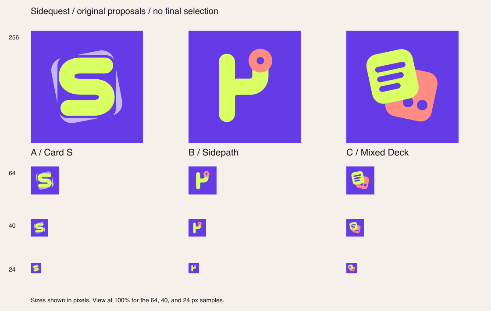

# Sidequest icon proposals

Status: **Proposed**, October 5, 2026. This is partial concept exploration for [issue #14](https://github.com/devofthings/sidequest/issues/14), with three original editable marks. Final identity selection and asset integration remain open. The current installed icon is unchanged.



View the sheet at 100% to inspect its actual small samples. Each SVG has a 1024 × 1024 canvas; individual PNG previews are 256 × 256 review images, not production assets.

## Directions

| Proposal | Idea | Editable master | Main tradeoff |
| --- | --- | --- | --- |
| A — Card S | A chunky lime S over a tilted lavender feed card. The strongest direct connection to the name. | [card-s.svg](card-s.svg) | The lavender card becomes a subtle rim at 24 px; the S remains dominant. |
| B — Sidepath | A thick route branches toward a coral destination: a short diversion from the feed. | [sidepath.svg](sidepath.svg) | The silhouette is clear at 24 px, but can resemble a lowercase h; its meaning needs the Sidequest name. |
| C — Mixed Deck | A lime reading card overlaps a coral playing card, expressing news plus games. | [mixed-deck.svg](mixed-deck.svg) | Most explicit product meaning; the smaller card details lose definition at 24 px. |

**Lead recommendation: A**, subject to the owner's selection. Its simple S survives reduction and provides a recognizable name cue. The recommendation is not an accepted branding decision. B emphasizes curiosity, and C emphasizes the mixed feed. Compare all three with the [earlier branching-card proposal](../design/LOGO.md); that image also remains unselected.

## References and originality

The owner's issue brief names [Picnic's official website](https://www.picnic.photos/) and [its App Store listing](https://apps.apple.com/us/app/photo-organizer-picnic/id6450713784). The publisher presents swipe-based sorting as a playful activity. We use that broad energy and the owner's purple/lime, chunky-shape brief; no Picnic icon, screenshot, tracing, or downloaded artwork is included.

The palette relates to the selected [MVP design](../DESIGN.md): lime, lavender, and coral, with an exploratory saturated purple icon background. Purple is a proposed branding choice, not a change to shared app tokens. All shapes, coordinates, and SVG paths were authored for Sidequest in this branch. There are no external fonts, symbols, embedded images, or AI-generated raster inputs.

## Production composition, after selection

[Apple's app-icon guidance](https://developer.apple.com/design/human-interface-guidelines/app-icons/) recommends a simple, unique core idea with few shapes and a 1024 × 1024 iPhone canvas. The system applies the corner mask. These masters therefore use a full square, opaque background without a baked outer corner radius; foreground shapes stay away from the edges.

For final production, evaluate separate background/foreground layers in Icon Composer, verify supported appearance variants and deployment compatibility, and inspect the actual home screen in the simulator before integrating the selected asset. Current platform guidance includes default, dark, clear, and tinted appearances; this flat review sheet does not validate them. See [Apple's Icon Composer documentation](https://developer.apple.com/documentation/xcode/creating-your-app-icon-using-icon-composer). No production variants, app asset catalog, simulator install, or physical-device test are claimed here.

## Actual checks and reproduction

The three SVGs were rendered locally using the already available Node.js runtime and Sharp library, without package installation, a service account, or paid generation. The resulting sheet was visually inspected: every primary silhouette remains distinct at 64 and 40 px; A is the clearest name cue at 24 px. B's h-like interpretation and C's reduced detail remain design tradeoffs, not hidden results.

The scoped renderer reproduces the three individual PNG previews and the size sheet:

```sh
NODE_PATH=<existing-node_modules-directory> node docs/logo-concepts/render.cjs
```

Run from the repository root with an existing Node.js/Sharp environment. Obtain the host's bundled paths through Codex's workspace-dependencies tool; no repository dependency is added. SVG XML parsing, canvas/background checks, PNG dimensions, and repository documentation checks are reported in the PR. Actual final identity and platform appearance validation await selection.

### Agent-grill self-assessment

| Question | Kind | Settled answer or pending choice | Evidence and verification |
| --- | --- | --- | --- |
| Can we create editable originals without paid generation? | Delegated technical choice | Author simple SVG geometry and render with the existing Sharp library. | The bundled library resolved locally; all three SVGs rendered successfully and their small samples were inspected. |
| Is final branding selected by the lead's general design authority? | Human-owned decision | Pending owner selection for issue #14. | The live logo issue explicitly requires it; this branch supplies concepts only. |
| Are these previews ready for production integration? | Fact | No; they are flat comparison images with editable masters. | Production appearance checks and actual app-icon integration remain separate acceptance criteria. |
